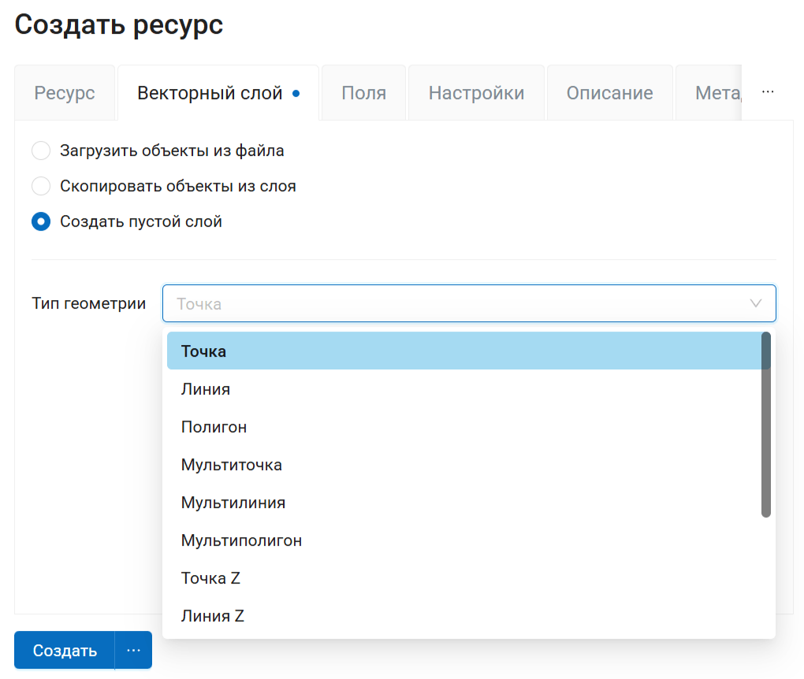
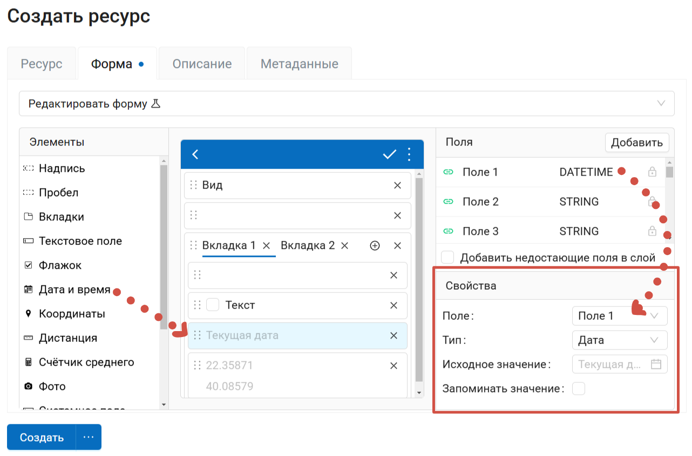
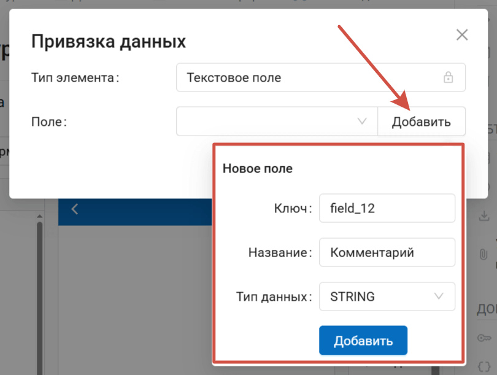
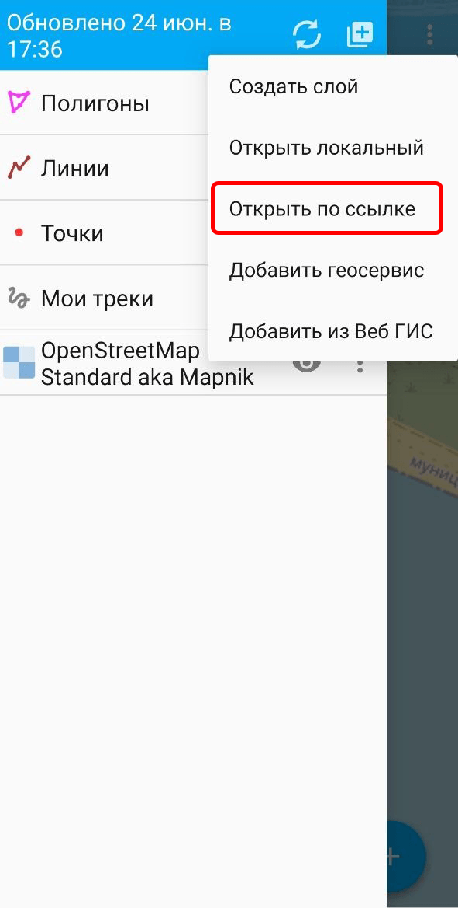

Сбор данных
===========

Чтобы начать сбор данных в поле при помощи мобильного приложения NextGIS Mobile:

* `Шаг 1. Создайте слой в Веб ГИС <https://docs.nextgis.ru/docs_howto/source/quick_data_collection.html#q-ngm-create-layer>`_
* `Шаг 2. Создайте в нём форму <https://docs.nextgis.ru/docs_howto/source/quick_data_collection.html#q-ngm-create-form>`_
* `Шаг 3. Загрузите слой в мобильное <https://docs.nextgis.ru/docs_howto/source/quick_data_collection.html#q-ngm-add>`_

.. _q_ngm_create_layer:

Шаг 1. Создание слоя
--------------------

* Откройте Веб ГИС, зайдите в нужную папку и нажмите **Создать ресурс**.
* Выберите **Векторный слой**.
* Выберите вариант "Создать пустой слой".
* Выберите нужный тип геометрии: точка, линия или полигон.
* Нажмите **Создать**.

Это создаст пустой слой, куда будут попадать данные.

   Создание пустого векторного слоя

.. note:: Если у вас уже есть слой, в который вы хотите собирать данные, можете использовать его.

.. _q_ngm_create_form:

Шаг 2. Создание формы
----------------------

* Внутри только что созданного или существующего слоя нажмите **Создать ресурс** и выберите **Форма**. Откроется конструктор формы, где можно её настроить.

* В конструкторе формы слева находится панель со списком всех элементов, которые можно добавить на форму.
* Чтобы **добавить элемент** на форму, перетащите его мышью в центральную часть конструктора - превью экрана устройства.

   Добавление элемента

* После того, как элемент помещён на форму, нужно указать поле (атрибут), куда будут попадать данные. Можно создать новое поле или выбрать готовое, если вы добавляете форму уже существующему слою со своей структурой. Для нового поля задайте название и тип данных.

   Создание поля для элемента

* Продолжайте добавлять элементы на форму, исходя из вашей структуры данных. Вы можете добавлять пробелы и надписи, чтобы визуально разделить элементы и сделать форму более читаемой. `Подробнее о настройках элементов <https://docs.nextgis.ru/docs_ngweb/source/form_elements.html#form-elements>`_.

* Когда все элементы добавлены, нажмите **Создать**.

.. _q_ngm_add:

Шаг 3. Добавление слоя в мобильное приложение
----------------------------------------------

* В Веб ГИС вернитесь к слою, нажав на его название. Скопируйте ссылку на слой.

* Откройте приложение NextGIS Mobile. Авторизуйтесь, введя адрес электронной почты NextGIS ID.
* Откройте список слоёв (три полоски), нажмите квадрат с плюсом и выберите **Открыть по ссылке**. Вставьте ссылку на слой.

   Добавление слоя по ссылке

Можно начать сбор данных. `Как добавить объекты в мобильном приложении <https://docs.nextgis.ru/docs_ngmobile/source/editing.html#ngmobile-add-geometry>`_.
