Georeference map by coordinates
=================================

In this tutorial we show you how to use coordinates to georeference a scanned topomap that has marginal information.

We'll use a Georeferencer tool to generate a new file in GeoTIFF format, a georeferenced image. 

.. contents::
   :local:
   :depth: 2

:download:`Download tutorial data <https://nextgis.com/tutorials/georeference_topo.zip>` (source: `U.S. Geological Survey <https://www.usgs.gov/>`_)

.. _topo_get_coord:

Step 1. Get coordinates
------------------------

Open the map in any image viewer.

* X coordinate (longitude) is marked in the top and bottom margins;
* Y coordinate (latitude) is marked in left and right margins. 

Coordinates can be marked in degrees or million feet/meters.

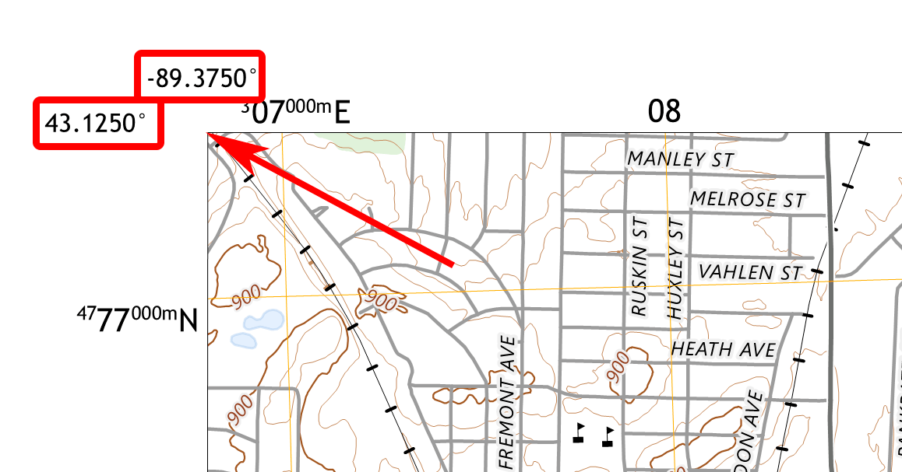

   Coordinates in degrees: these are the coordinates of the map corner. In this case the longitude is 60°00' and the latitude is 57°00'

To enter the coordinate in degrees, use an appropriate CRS. A popular CRS using degrees is EPSG:4326.

The map may only display the changing part of the coordiantes, so see if there are small numbers before and after the big number in the corner.
If you use million meters, you'll at least need to add three zeroes at the end. 

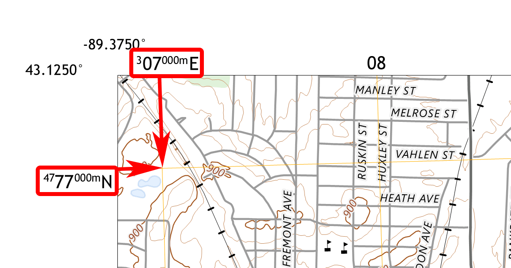

   Coordinates in meters: these are coordinates of the grid crossing. In this case X 307000 m, and Y 4777000 m

To use the coordinates in meters you need to know the projection of the map.

.. _topo_projection:

Step2. Define map projection
----------------------------

USGS topo maps use North American Datum 1983 and Gauss-Krüger projection. EPSG codes are EPSG:269XX where XX is the zone number. In the Gauss-Krüger projection, the Earth is divided into zones by meridians every 6 degrees. 

In our example the city of Madison is in UTM zone 16. The projection information can be found in the bottom left corner of the map.

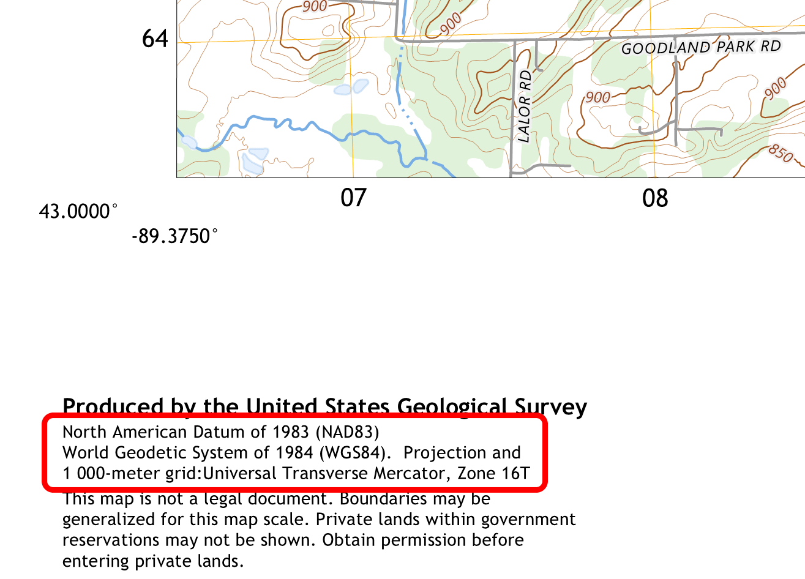

   SRS information on the map

This coordinate system will need to be specified in the transformation parameters and when entering points.

.. _topo_points:

Step 3. Add GCP points
----------------------

In QGIS create a new project and in the bottom right corner select the SRS of the map: ``NAD83 / UTM zone 16N, EPSG:26916``

Click :menuselection:`Layer --> Georeferencer` |mGeorefRun|. 

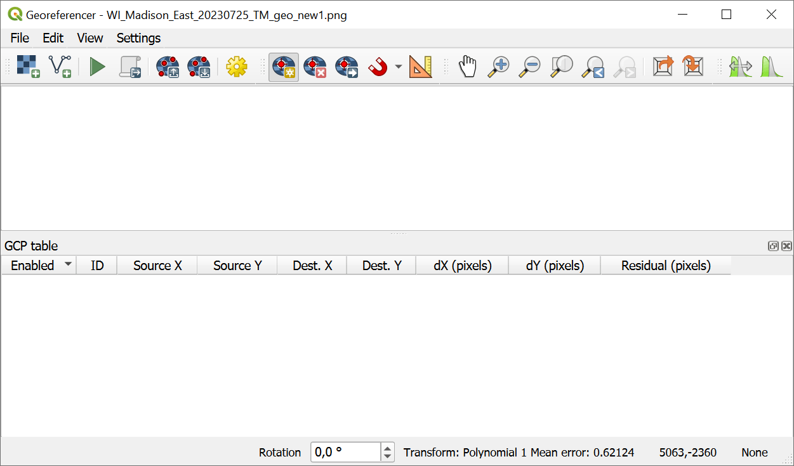
   
   Georeferncer interface

In the Georeferencer window open the scanned map by clicking |mActionAddRasterLayer|. 

Now you need to add ground control points that will be used to match the map with the coordinates. Control points must be as far apart as possible, because you can only guarantee georeferencing precision within the polygon this points make. So pick the grid crossings that are the closest to the corners of the map.

Zoom in to the top left corner and find the coordinate marks. In the Georeferencer toolbar select |button_georef_add_point| **Add GCP point** and click on the crossing. In the pop-up window enter the values of X (top) and Y (left).

Then pick the coordinate system of the zone. 

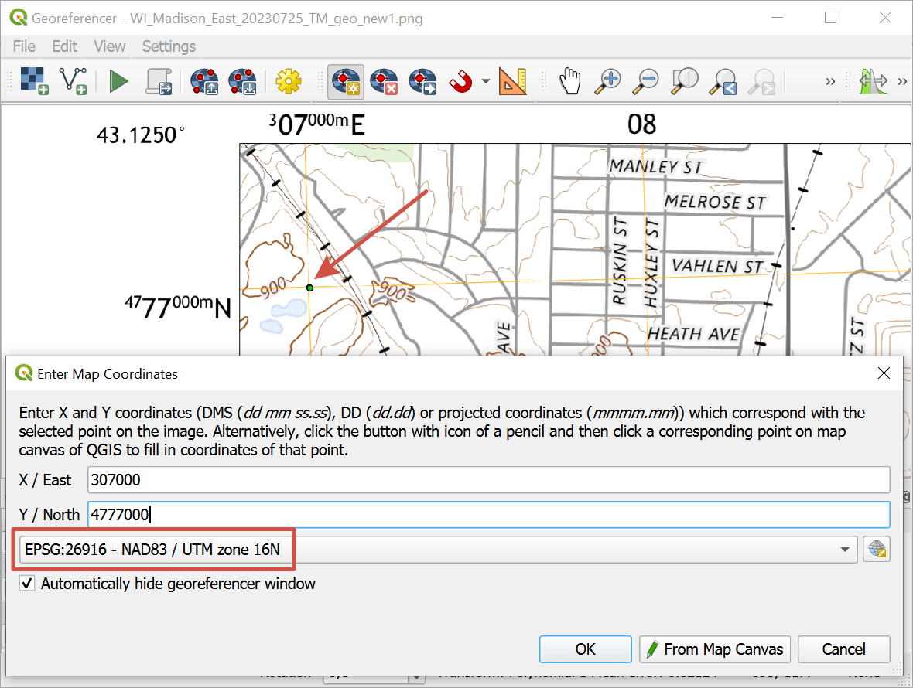
   
   Entering GCP coordinates

In the example, for Madison sity we set NAD83 / UTM zone 16N, EPSG:26916. 

Next zoom in to the top right corner of the map, find the closest crossing and click on it. When entering the X and Y values, remember to use the full value, not just the part marked above the grid. In our example for the X coordinate you need to add 3 before the number and three zeroes afer it.

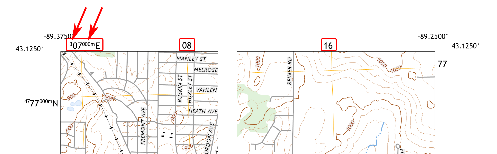

   Full coordinate value on the left and partial values

You need to add 4 to 9 points depending on the transformation type. 

* For maps with rectangular projections it is recommended to use transformation type Polynomial 1, it requires 4 points.
* For maps with conic projections (where you can see the meridian lines diverging) we recommend Polynomial 2, it requires 6 points.

For this map we'll use Polynomial 1, so add 4 points + one additional point in the center. Uncheck the additional point, it will only be used to double-check the accuracy of the georeferencing.

.. _topo_parameters:

Step 4. Set up transformation parameters
----------------------------------------

After all the points are added open, click on |button_georef_settings| icon in the toolbar or go to :menuselection:`Settings ‣ Transformation settings`

For topographic maps, we recommend setting the following parameters: 

* Transformation type - Polynomial 1;
* Target coordinate system - as determined, EPSG:26916;
* Target raster - name of the new GeoTIFF, by default uses the name of the source image;
* Resampling method - Nearest neighbor;
* Use 0 for transparency when needed.
* Save checkpoints.

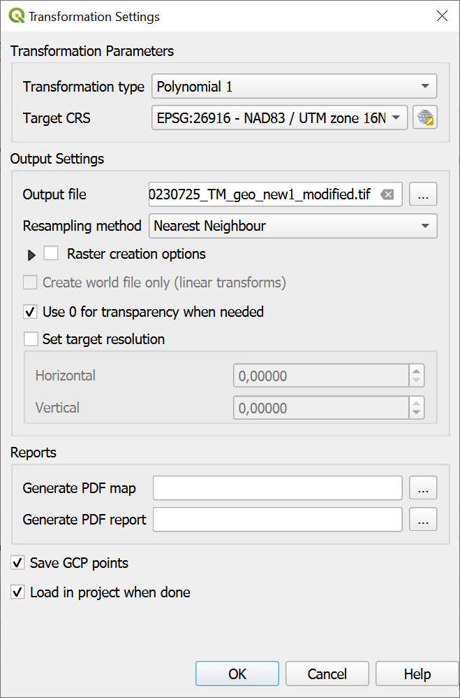

   Transformation parameters for a topographic map in a rectangular coordinate system

.. note:: Control points can be saved to your device as a backup at any time. Click |mActionSaveGCPpointsAs| or go to ``File ‣ Save GCP points as...``. Save them to the default folder and they'll be automatically loaded each time you run the Georeferencer.

After setting up Transformation parameters click **OK** to view transformation errors.

.. _topo_check:

Step 5. Check accuracy
-----------------------

Check the Residual column. Usually the goal is to get a residual within 1 pixel.

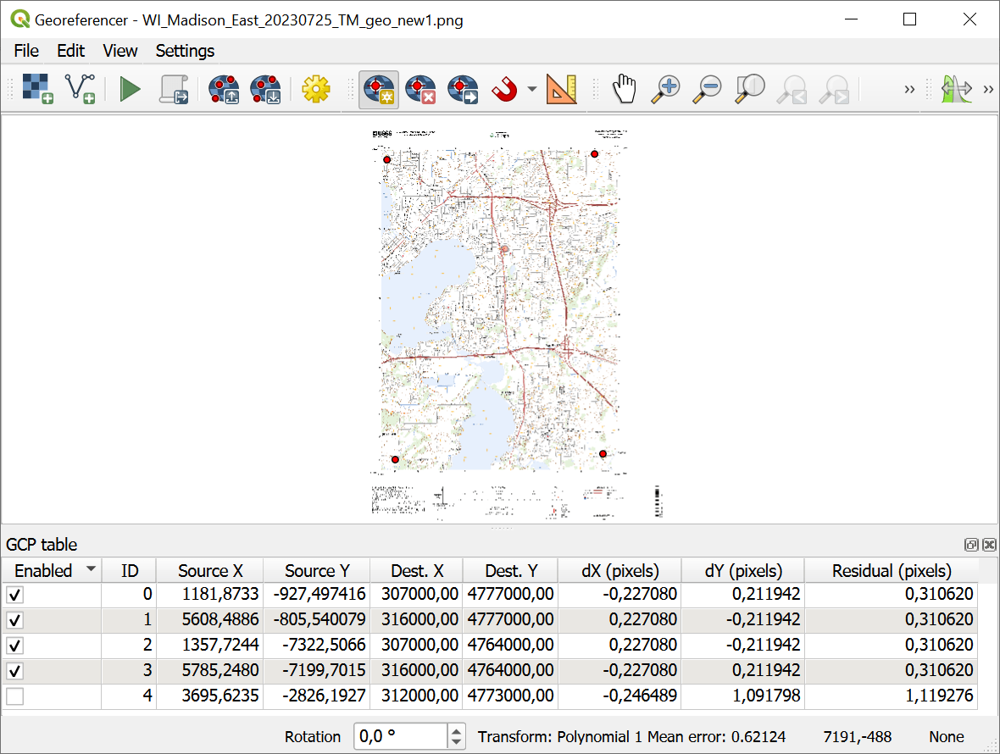

   Image georeferenced with small residual

Acceptable residual depends on the raster resolution. For instance, for a raster 10.000 by 10.000 pixels 10 pixel residual is fine, but for a 1.000 by 1.000 raster it's big.

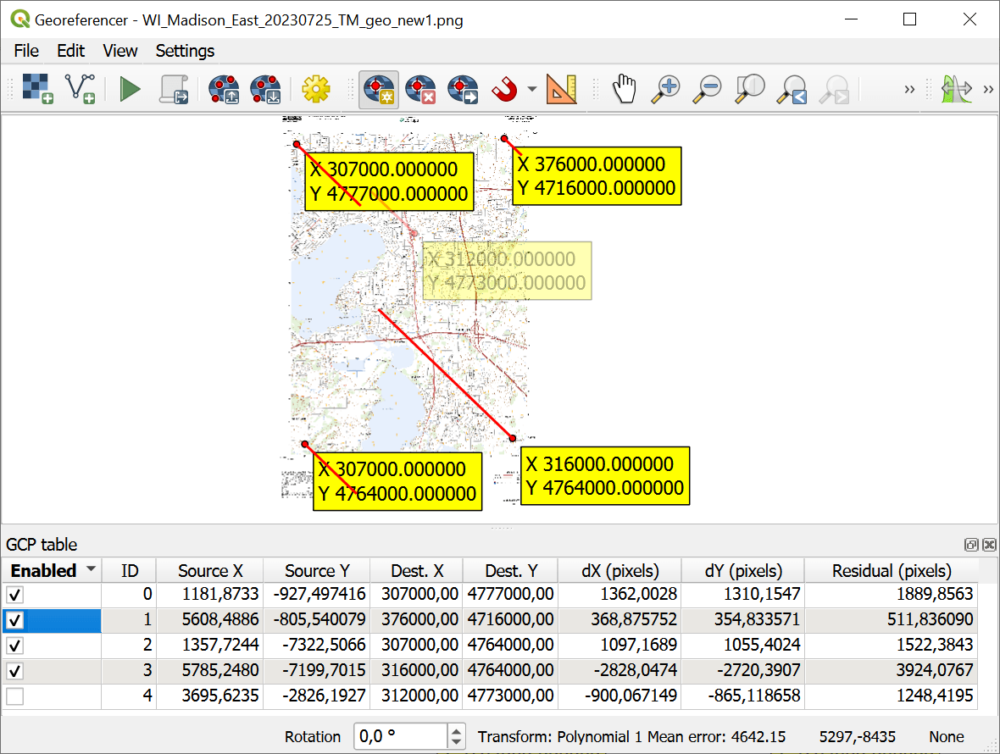

   Image georeferenced with big errors

On this screenshot you can see long red lines and big residual in the table. This has happened because of icorrectly added numerical coordinates for the second point.

To view the coordinates of each control point on the map, go to :menuselection:`Settings --> Configure Georeferencer --> Show coordinates`.

Check the numbers you entered. After correcting the numbers, go to Transformation parameters again and click **Ok** to recalculate the residual.

If the coordinates are correct, but the residual is still big, check the transformation type.

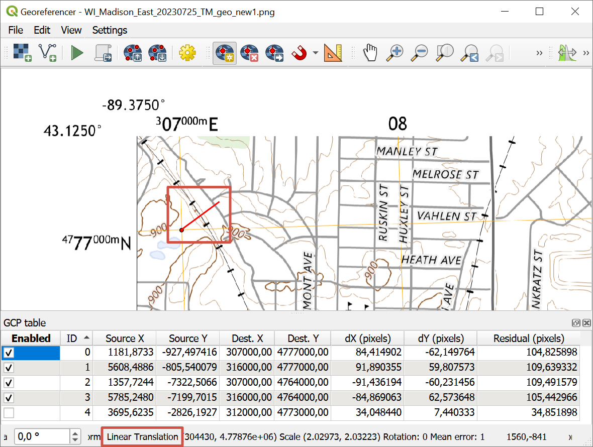

   Big residual is caused by the incorrectly chosen transformation type

After checking all the parameters it's time to run the georeferencing itself.

Step 6. Run the georeferencing
------------------------------

Start the georeferencing by clicking on the green arrow button |button_start_georef| in the toolbar or selecting :menuselection:`File ‣ Start georeferencing`.

Georeferenced raster is added to QGIS project in GeoTIFF format. You can check it against a basemap.

Add a familiar basemap using NextGIS QuickMapServices plugin. Compare the georeferenced map with it by tweaking its opacity in the :menuselection:`Layer properties --> Transparency`.

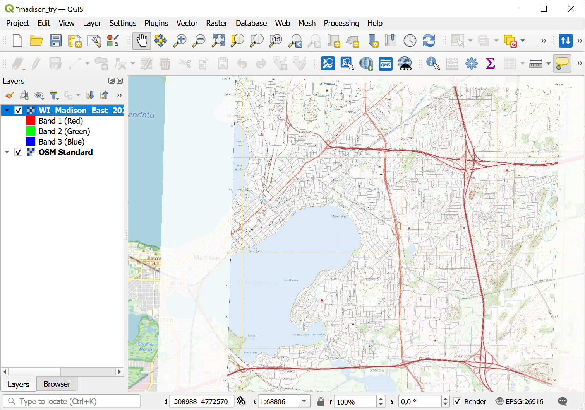

   Accurately georeferenced image

.. seealso:: 

  `How to share your map online <https://docs.nextgis.com/docs_howto/source/quick_webmap.html>`_

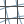

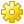

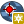

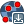

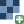

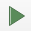